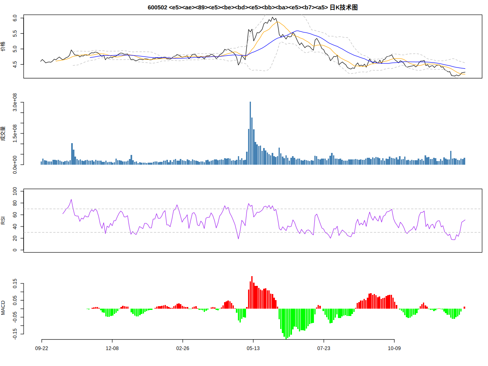

# stockr：A股量化投顾 R 包

**stockr** 是一个纯 base R、零依赖的 A 股投资决策支持工具包。
它把"看行情 → 算指标 → 打分 → 给建议 → 配仓位 → 回测验证"做成一条完整工作流，
开箱即用，默认覆盖 4 只股票：**安徽建工(600502)、中国电建(601669)、博汇纸业(600966)、京运通(601908)**。

> ⚠️ 本包是量化决策**辅助工具**，所有评分仅供参考，不构成投资建议。市场有风险，入市需谨慎。

## 功能一览

| 模块 | 函数 | 说明 |
|---|---|---|
| 数据获取 | `stk_history()`, `stk_quote()` | 新浪历史日K + 腾讯实时行情，纯 base R 解析 |
| 技术指标 | `ma()`, `ema()`, `rsi()`, `macd()`, `bollinger()`, `atr()`, `roc()` | 全部向量化实现 |
| 综合评分 | `trend_score()`, `value_score()`, `momentum_score()` | 趋势/估值/动量三维度 0–100 打分 |
| 投资建议 | `advice()`, `advice_universe()`, `advice_report()` | 加权综合 + 中文建议标签 + 星级报告 |
| 组合优化 | `opt_max_sharpe()`, `opt_min_var()`, `opt_risk_parity()`, `opt_equal()` | 多头组合权重优化 |
| 参数调优 | `tune_trend()` | 网格搜索 + 前60%训练/后40%验证 |
| 回测 | `backtest()`, `perf_metrics()`, `sig_trend()` | 信号回测与业绩指标 |
| 可视化 | `plot_stock()` | 价格+均线+布林 / 成交量 / RSI / MACD 四联图 |

## 安装

```r
# 方式一：从 GitHub 安装（推荐）
if (!requireNamespace("remotes", quietly = TRUE)) install.packages("remotes")
remotes::install_github("Chuang2016/stockr")

# 方式二：本地源码安装
# 下载仓库后在 R 中运行：
# install.packages("/path/to/stockr", repos = NULL, type = "source")
```

```r
library(stockr)
```

## 快速开始：四只股票一键诊断

```r
ad <- advice_universe()   # 抓取行情 → 三维度打分 → 排名
advice_report(ad)         # 打印中文报告
```

真实运行输出（2026-10-12，基于 10 月 9 日收盘价）：

```
============ 投资建议报告 ============
基准日期: 2026-10-12  (权重 趋势50%/估值30%/动量20%)

#1 中国电建(601669)  ★★★★☆
   现价 4.58  涨跌 +0.00%  |  趋势 49  估值 77  动量 68  =>  综合 61.2  [推荐]
#2 安徽建工(600502)  ★★★☆☆
   现价 4.25  涨跌 +0.24%  |  趋势 44  估值 95  动量 31  =>  综合 56.7  [中性偏多]
#3 京运通(601908)  ★★★☆☆
   现价 2.96  涨跌 +1.37%  |  趋势 56  估值 22  动量 68  =>  综合 48.1  [中性偏多]
#4 博汇纸业(600966)  ★★☆☆☆
   现价 4.81  涨跌 -0.62%  |  趋势 34  估值 27  动量 49  =>  综合 34.9  [谨慎]

说明: 趋势=技术面(MA/MACD/RSI/布林/量价), 估值=基本面(PE/PB/ROE/股息), 动量=60日涨跌历史分位.
风险提示: 量化评分仅供参考, 不构成投资建议; 市场有风险, 入市需谨慎.
```



```r
# 单只股票深度诊断
advice("600502")

# 实时行情
stk_quote("601669")
```

## 核心概念：三维度评分体系

`advice()` 把一只股票拆成三个可解释的维度打分（0–100），再按权重合成：

```
综合得分 = 0.5 × 趋势分 + 0.3 × 估值分 + 0.2 × 动量分     （默认权重，可调）
```

| 维度 | 构成 | 经济含义 |
|---|---|---|
| **趋势分** `trend_score()` | 股价 vs 60日均线(25分) + 快慢均线多头(20分) + MACD红柱(15分) + MACD走强(5分) + RSI位置(15分) + 布林位置(10分) + 量价配合(10分) | 技术面强弱 |
| **估值分** `value_score()` | PE(40分) + PB(25分) + ROE(20分) + 股息率(15分)，基于 `fund_snapshot()` | 基本面便宜程度 |
| **动量分** `momentum_score()` | 当前60日涨跌幅在自身过去250天历史中的分位数 | 动量强弱 |

综合得分 → 中文建议标签：

| 得分 | 标签 | 含义 |
|---|---|---|
| ≥75 | 强烈推荐 | 趋势、估值、动量三强 |
| 60–75 | 推荐 | 至少两维度优秀 |
| 45–60 | 中性偏多 | 可持有，等待催化 |
| 35–45 | 中性 | 观望为主 |
| 25–35 | 谨慎 | 控制仓位 |
| <25 | 回避 | 三弱，远离 |

## 模块详解

### 1. 数据获取：免费实时数据源

```r
# 历史日K（新浪财经公开接口，默认最近250个交易日）
df <- stk_history("600502", n = 250)
head(df)
#         date open high  low close   volume
# 1 2025-10-13 4.35 4.38 4.30  4.36 20118345
# ...
# 返回 data.frame(date, open, high, low, close, volume)，按日期升序

# 实时行情（腾讯公开接口）
q <- stk_quote("600502")
# $name 价格 $pct_chg 涨跌幅 $high/$low $volume(手) $amount(万元) ...

# 股票代码自动识别：600502 / sh600502 / "中国电建" 混写都行
stk_code("600502")   # "sh600502"
stk_universe()       # 默认四只股票对照表
```

> 数据源为公开免费接口，仅供个人研究使用，请勿高频抓取。

### 2. 技术指标（全部纯 base R）

```r
df <- stk_history("600502", 250)
ma(df$close, 20)          # 简单均线
ema(df$close, 12)         # 指数均线
rsi(df$close, 14)         # RSI(0-100)
macd(df$close)            # data.frame(dif, dea, hist)
bollinger(df$close)       # data.frame(mid, upper, lower, pctb)
atr(df, 14)               # 平均真实波幅（仓位管理用）
roc(df$close, 60)         # 60日涨跌幅%
```

### 3. 组合优化：四种配仓方案

```r
pm <- ret_matrix(c("600502", "601669", "600966", "601908"), n = 250)
ann_stats(pm$R)                    # 年化收益/波动/夏普一览

opt_max_sharpe(pm$R)$weights       # 最大夏普（多头，随机搜索2万次）
opt_min_var(pm$R)$weights          # 最小方差（保守型）
opt_risk_parity(pm$R)$weights      # 风险平价（每只股票贡献相同风险）
opt_equal(pm$R)$weights            # 等权重（基准）
```

真实运行（过去250个交易日，四只股票年化收益均为负——如实反映这段熊市）：

```
# 最大夏普：600502 0.003 / 601669 0.001 / 600966 0.984 / 601908 0.012
# 风险平价：0.301 / 0.272 / 0.218 / 0.209
# 最小方差：0.428 / 0.329 / 0.124 / 0.119
```

解读：最大夏普会押注"相对最不差"的标的（此处是博汇纸业，因其跌幅最小）；
风险平价和最小方差更分散，适合求稳。**优化器只懂历史数据，不懂未来**，
建议以风险平价/等权重为锚，再按 `advice_universe()` 的排名做战术倾斜。

### 4. 参数调优：让策略自己选参数

```r
# 网格搜索趋势策略的 (快均线, 慢均线)，前60%训练、后40%验证
tune_trend("600502", fast_grid = c(5, 10, 15), slow_grid = c(20, 30, 60))
# $best: fast 10 / slow 30；$train_sharpe: 2.16；$test_sharpe: 1.28
```

训练集夏普 2.16、验证集 1.28——参数在样本外依然有效，没有严重过拟合。

### 5. 回测：先验证，再相信

```r
df <- stk_history("600502", 300)
sig <- sig_trend(df, fast = 10, slow = 30)  # 金叉做多、死叉空仓
bt <- backtest(df, sig, cost = 0.0003)       # 万3手续费
bt$metrics
# total_ret   ann_ret   ann_vol    sharpe    max_dd  win_rate    calmar
#   -0.195    -0.170     0.142    -1.199    -0.241     0.130    -0.707
bt$trades  # 12（交易次数）
```

这个例子很说明问题：同一只股票、同一个趋势策略，在过去300天是亏钱的
（震荡市中趋势策略反复被打脸）。**回测的意义就是诚实**——
先看到策略在哪里亏钱，再决定要不要用。

```r
# 四联技术图（价格+均线+布林 / 成交量 / RSI / MACD）
plot_stock(df, "600502 安徽建工")
plot_stock(df, "600502", file = "anhuijianguo.png")  # 存 PNG
```

## 进阶：如何得到"最佳"投资建议

没有包能保证"最佳"，但 stockr 把**可优化的环节**都做成了函数，
你可以按自己的风险偏好调出最适合的版本：

1. **调评分权重**：保守型投资者加重估值
   ```r
   advice_universe(w = c(0.3, 0.5, 0.2))  # 趋势30% / 估值50% / 动量20%
   ```
2. **调趋势参数**：用 `tune_trend()` 给每只股票找最优 (fast, slow)，
   再把最优参数传给 `trend_score(df, fast, slow)`。
3. **组合层面**：`advice_universe()` 定方向（买哪只），
   `opt_risk_parity()` 定仓位（买多少），两者结合。
4. **更新基本面**：每季财报后编辑 `R/fund_snapshot.R`（即 `fund_snapshot()` 函数）
   中的 PE/PB/ROE/营收利润增速，估值分会自动跟上。

## 基本面快照

`fund_snapshot()` 内置四只股票 2026 年中报 + 最新行情的基本面
（2026-10-12 采集）。它是**静态**的——财报季后记得手动更新，
否则估值分会逐渐失真。

## 风险提示与局限

- 量化评分基于**历史数据**，不预测未来；黑天鹅、政策突变不在模型内。
- 免费行情接口可能限流或变更，抓取失败时函数返回 NULL 并警告。
- 组合优化假设"历史协方差 ≈ 未来协方差"，熊市中最大夏普会集中押注，
  请结合风险平价/等权重使用。
- 本包仅供个人研究学习，不构成投资建议。

## FAQ

**Q: 能加别的股票吗？**
A: 能。`stk_history("000001")` 等任意 A 股代码都支持；
`advice("000001")` 直接出建议。默认四只是 `stk_universe()` 定义的。

**Q: 数据多久更新？**
A: 每次调用都实时抓取。盘中用 `stk_quote()` 看实时，收盘后用
`stk_history()` 复盘。建议每天收盘后跑一次 `advice_report(advice_universe())`。

**Q: 为什么我的综合分和你的不一样？**
A: 评分随行情每天变化；且 `opt_max_sharpe()` 用随机搜索，
设 `seed` 参数可复现。

## 更新日志

- **v0.1.0** (2026-10-12)：首个版本。数据获取、技术指标、三维度评分、
  中文投资建议、4 种组合优化、参数调优、回测、四联图；
  `R CMD check` 0 ERROR。
